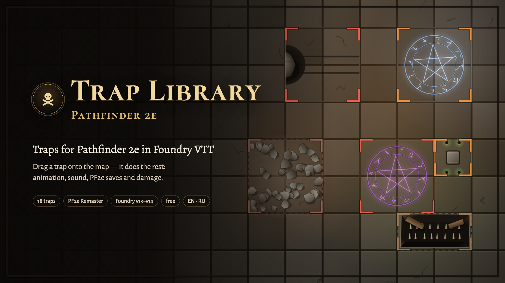

# Западня PF2e · Trap Library PF2e

| 🐉 [D&D 5e](https://github.com/klimenkoyg/foundry-traps) | 🧭 **Pathfinder 2e** | 🎲 [Any system / Любая система](https://github.com/klimenkoyg/foundry-traps-universal) |
|:---:|:---:|:---:|
| [Русский](https://github.com/klimenkoyg/foundry-traps#readme) · [English](https://github.com/klimenkoyg/foundry-traps/blob/main/README.en.md) | [Русский](README.md) · **English** | [Русский](https://github.com/klimenkoyg/foundry-traps-universal#readme) · [English](https://github.com/klimenkoyg/foundry-traps-universal/blob/main/README.en.md) |



A trap library for **Pathfinder 2e** in Foundry VTT, with animations and sounds. The GM drags a trap
onto the map — it becomes a hidden region that fires when a character steps in: an effect on the
scene, a save or an attack with four degrees of success, damage with immunities, weaknesses and
resistances, persistent damage, a valued condition and a chat card.

This is a separate module built on the D&D 5e Trap Library: the animations, sounds, windows and map
buttons are the same, the rules are Pathfinder 2e (Player Core and GM Core, Remaster).

## Installation

In Foundry: **Add-on Modules → Install Module**, paste the manifest URL at the bottom:

```
https://github.com/klimenkoyg/foundry-traps-pf/releases/latest/download/module.json
```

- Foundry VTT **v14** (pf2e 8.x) or **v13** (pf2e 7.x).
- System — **Pathfinder 2e**: saves, skills, proficiency ranks, damage and conditions come from it.
- No other modules needed: animations and sounds are built in. Optionally, [Sequencer](https://foundryvtt.com/packages/sequencer)
  and the free [JB2A](https://foundryvtt.com/packages/JB2A_DnD5e) (it works for PF2e too). In a trap's
  settings you can pick any installed JB2A animation — JB2A Patreon gives more choice.

## How to use

Click the **skull** in Foundry’s left toolbar — the “Trap Library PF2e: traps” group (GM only). The
library window opens. Pick the **party level** (1–20) at the top: every trap adapts to it. Drag a
trap onto the map — it becomes a hidden region under the cursor.

Each trap on the map has GM buttons: eye (show to players or hide), key (disable with the selected
token), ▶ (fire now), ✥ (drag), ↻ (turn 90°), sliders (configure), footprints (add a trigger).

## Your own traps and hazards

The **My traps** tab holds the traps you configured and saved; every GM of the world sees them.

- **New trap** opens the settings with a starting trap (a level 0 setback): name it and adjust the
  numbers. A hazard is made the same way: kind Natural and “When entered and every turn inside”.
- **Save to file** saves all your traps to one .json file, ⤓ on a card saves one. Use it to move
  traps to another world or share them with another GM. **Load from file** first shows what will be
  added, what replaces one of yours (the same file loaded again) and what doesn't fit (a D&D 5e file
  — its numbers are different). Server pictures travel inside the file and are saved to the world
  folder `worlds/<world>/ssl-traps/` on load.
- The top of the settings window has the **kind** (mechanical, magical or natural — the library
  filter uses it) and **Visible from the start**: such a trap goes on the map already revealed to
  players. For a trap on the scene this box does the same as the eye.
- **Fires: When entered and every turn inside** — in combat the trap also strikes at the start of
  the turn of everyone standing in its area, one card per turn (“starts its turn in the area”).
  Outside combat it fires only when entered.
- **Picture on the map** replaces the module's drawing with your own picture: a file on the Foundry
  server (Choose…) or an https link. A link to another site only shows if that site allows its
  pictures on other sites; a picture on the Foundry server is more reliable.
- **JB2A animation**, with Sequencer and JB2A installed: any installed animation, “Match the
  built-in one” or “None — built-in only”. Arrows, bolts and beams fly across the whole area.

### Natural hazards

The Natural filter in the library. Numbers are for a level 1 party, from the GM Core tables for the
hazard's level, and grow with the party level like any trap. Hazards that strike every turn deal
about half a simple hazard's damage. On the map they show a hazard sign; you can set a picture.

| Name | Lvl | Severity | Check | Damage | Condition | Notes |
|---|---|---|---|---|---|---|
| Brown Mold | 2 | dangerous | basic Fortitude DC 18 | 1d10+4 cold | — | visible from the start, every turn |
| Yellow Mold | 2 | dangerous | Fortitude DC 18, success avoids; everyone in the area | 2d10+7 poison | sickened 1 | visible from the start |
| Green Slime | 0 | setback | Reflex DC 16, success avoids | 1d6+2 acid | — | every turn |
| Razorvine | 0 | setback | basic Reflex DC 16 | 1d6+2 slashing | — | visible from the start, every turn |
| Quicksand | 0 | setback | — | — | immobilized | Stealth DC 19, Athletics DC 16 to escape |
| Toxic Fumes | 1 | dangerous | basic Fortitude DC 17 | 1d6+3 poison | sickened 1 | visible from the start, every turn |

## The PF2e rules here

### Trap level and XP

The library describes traps for a level 1 party. Pick a party level and the module recalculates the
trap level and its numbers from the GM Core “Building Hazards” tables: Stealth and Disable DCs, save
DC, attack, simple-hazard damage and the required rank. The card shows the level and the XP the trap
is worth to that party (a simple hazard is worth a fifth of a creature of its level).

- **Setback** — one level below the party, **dangerous** — same level or one above, **deadly** —
  two or three above.
- **“Damage doesn’t grow with level”** is for falls and other physical things: a pit deals half its
  depth, and the escape DC stays the same at any level. Stealth, disable, save and attack always grow.
- The configure window shows what the trap becomes for parties of level 1, 4, 8, 12, 16 and 20.

### Degrees of success

Every check has four outcomes: 10 over the DC — critical success, at least the DC — success, below —
failure, 10 under — critical failure. A natural 20 raises the result one step, a natural 1 lowers it.
When the system has already adjusted the degree (Evasion and the like), the module uses its result.

- **Basic save:** critical success — no damage, success — half, failure — full, critical failure —
  double.
- **“Success avoids it”** (pit, net, sleep gas): success — nothing, failure — damage and condition,
  critical failure — the condition one step worse.
- **Attack vs AC:** a hit deals damage, a critical hit double.
- **Persistent damage** (acid, poison, fire, bleed) isn’t rolled up front: the system puts it on the
  target on a failure or hit, doubled on a crit, and rolls it at the end of its turn.
- **Valued conditions:** frightened 2, sickened 1, drained 1… The module sets “at least” the value: a
  second trap won’t turn frightened 1 into 3.
- The system applies the damage itself — with immunities, weaknesses and resistances, its own message
  and undo button.
- Rolls are made “against a trap”: feats like **Trap Finder** add their bonuses to saves, AC and
  Perception.

### Noticing a trap

PF2e has no passive Perception. When a player character comes near a trap (within “notice from” and
in line of sight), the GM **secretly** rolls their Perception against the trap’s Stealth DC — once
per trap. Only the GM sees the result.

- A trap with **no rank** can be noticed by anyone, even without Searching.
- A trap **with a rank** (trained, expert…) is only found by a character who is **Searching** —
  Search selected in exploration — and has at least that Perception rank. If your group doesn’t track
  exploration activities, set “Everyone, as if all were Searching” in the settings.
- The search button on the scene tab makes a secret check for the selected characters right now.

### Disable a Device

The GM presses the key with a token selected (or a player uses their own key at a trap they know
about). The roll uses the trap’s skill: Thievery for mechanisms; Arcana, Occultism, Religion or
Nature for magic; Athletics for the boulder.

- Without the required **skill rank** you can’t attempt it — the module says so.
- Critical success — two successes, success — one, failure — nothing, **critical failure — the trap
  goes off** on whoever was tinkering.
- Some traps need several successes (the scything blade needs two, one per hinge): progress is kept
  until the trap is rearmed.

## Settings

- **Secret Perception near traps** — whether characters coming near a trap get a check.
- **Who can notice a trap on approach** — by the rules (ranked traps only by Searching characters) or
  everyone.
- **Who rolls saves** — players with a button in the card, or the module.
- **When to apply damage** — on the GM’s button or right away.
- **Who rolls Disable a Device** and **players’ own key**.
- Animations (built-in or JB2A), volume, who sees the card, map buttons.

## For macros

```js
const traps = game.modules.get("ssl_traps_pf2e").api;
traps.open();                                  // GM window
traps.place("fireJet", { x, y }, { party: 5 }); // place for a level 5 party
traps.fire(behavior);                          // fire manually
```

## Not yet

- Complex hazards with initiative and a routine of their own. There is only “every turn”: a strike
  at the start of the turn of whoever stands in the area.
- Poisons and diseases with stages: poison is damage, persistent damage or a condition.
- Breaking a trap with damage (AC, Hardness, HP) and dispel magic as a way to disable it.
- Importing hazards from the PF2e compendium.

## Development

```bash
npm test        # trap rules without Foundry
npm run check   # syntax, translations, templates, manifest files
npm run build   # dist/module.zip and dist/module.json
```

Bench with a Foundry and pf2e mock: `python3 scripts-dev/serve.py`, then
`http://localhost:8766/dev/harness/` (add `?lang=en` for English).

Table numbers are from GM Core (Pathfinder 2e Remaster) under the ORC license, via Archives of Nethys.

## Ideas and bugs

To suggest an idea, use the “Suggest an idea” button at the bottom of the window (GM only) or go
straight to the [form](https://forms.gle/FuMwJ2JzSn3DHCTc7). Report bugs in
[Issues](https://github.com/klimenkoyg/foundry-traps-pf/issues).

## Rights

© 2026 Yuriy Klimenko. You may use the module for free in any games, including paid ones, and share
it — whole and unchanged. Changing the code, taking parts into other modules or selling it requires
the author’s written consent. Configuring traps and saving your own in the module window is use, not
modification. Full terms are in [LICENSE](LICENSE).

The trap mechanics follow the Pathfinder 2e rules (Player Core, GM Core; Paizo, ORC license); the trap
texts, animations and sounds are original. This module is not affiliated with Paizo.
