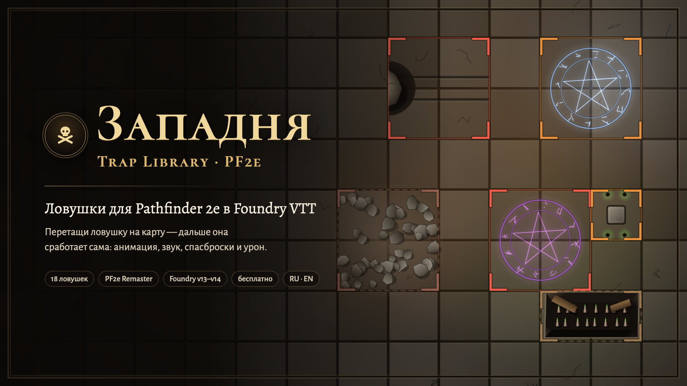

# Западня PF2e · Trap Library PF2e

| 🐉 [D&D 5e](https://github.com/klimenkoyg/foundry-traps) | 🧭 **Pathfinder 2e** | 🎲 [Any system / Любая система](https://github.com/klimenkoyg/foundry-traps-universal) |
|:---:|:---:|:---:|
| [Русский](https://github.com/klimenkoyg/foundry-traps#readme) · [English](https://github.com/klimenkoyg/foundry-traps/blob/main/README.en.md) | **Русский** · [English](README.en.md) | [Русский](https://github.com/klimenkoyg/foundry-traps-universal#readme) · [English](https://github.com/klimenkoyg/foundry-traps-universal/blob/main/README.en.md) |



Библиотека ловушек для **Pathfinder 2e** в Foundry VTT, с анимациями и звуками. Ведущий перетаскивает
ловушку на карту — она встаёт скрытой областью и срабатывает, когда на неё наступает персонаж: эффект
на сцене, спасбросок или атака по четырём степеням успеха, урон с иммунитетами, слабостями и
сопротивлениями, продолжительный урон, состояние со значением и карточка в чате.

Это отдельный модуль на основе «Западни» для D&D 5e: анимации, звуки, окна и кнопки на карте те же,
а правила — Pathfinder 2e (Player Core и GM Core, Remaster).

## Установка

В Foundry: **Модули → Установить модуль**, внизу окна вставить адрес манифеста:

```
https://github.com/klimenkoyg/foundry-traps-pf/releases/latest/download/module.json
```

- Foundry VTT **v14** (pf2e 8.x) или **v13** (pf2e 7.x).
- Система — **Pathfinder 2e**: спасброски, навыки, ранги, урон и состояния берутся из неё.
- Сторонние модули не нужны: анимации и звуки свои. По желанию — [Sequencer](https://foundryvtt.com/packages/sequencer)
  и бесплатный [JB2A](https://foundryvtt.com/packages/JB2A_DnD5e) (он подходит и для PF2e). В настройке
  ловушки можно выбрать любую установленную анимацию JB2A — с JB2A Patreon выбор больше.

## Как пользоваться

В левой панели Foundry нажмите на **череп** — группа «Западня PF2e: ловушки» (только у ведущего).
Откроется окно с библиотекой. Сверху выберите **уровень партии** (1–20): все ловушки подстроятся под
него. Перетащите ловушку на карту — она встанет скрытой областью под курсором.

У каждой ловушки на карте — кнопки ведущего: глаз (показать игрокам или спрятать), ключ (обезвредить
выделенным токеном), ▶ (сработать сейчас), ✥ (перетащить), ↻ (повернуть на 90°), ползунки (настроить),
след (добавить триггер).

## Свои ловушки и опасности

Вкладка **«Мои ловушки»** — ловушки, которые вы настроили и сохранили; их видят все ведущие мира.

- **«Новая ловушка»** — настройка с заготовкой (помеха уровня 0): остаётся назвать её и поправить
  числа. Опасность делается так же: вид «Природная» и «Когда входят и каждый ход внутри».
- **«Сохранить в файл»** — все свои ловушки одним файлом .json, ⤓ у карточки — одну. Так их
  переносят в другой мир или отдают другому мастеру. **«Загрузить из файла»** сначала показывает,
  что добавится, что заменит вашу ловушку (тот же файл загрузили ещё раз) и что не подходит (файл
  для D&D 5e — числа там другие). Картинки с сервера лежат внутри файла и при загрузке сохраняются в
  папку мира `worlds/<мир>/ssl-traps/`.
- В шапке окна настройки — **вид** (механическая, магическая или природная: по нему работает фильтр
  библиотеки) и **«Видна сразу»**: такая ловушка встаёт на карту уже показанной игрокам. У ловушки
  на сцене эта галочка — то же, что глаз.
- **«Срабатывает: Когда входят и каждый ход внутри»** — в бою ловушка бьёт ещё и в начале хода
  каждого, кто стоит в её области, — по карточке на ход («начинает ход в области»). Вне боя — только
  когда входят.
- **«Картинка на карте»** — своя картинка вместо рисунка модуля: файл на сервере Foundry
  («Выбрать…») или ссылка https. Ссылка на чужой сайт покажется, только если сайт разрешает показ
  своих картинок на других сайтах; надёжнее выложить картинку на сервер Foundry.
- **«Анимация JB2A»** — если стоят Sequencer и JB2A: любая из установленных, «Подобрать к
  встроенной» или «Не нужна — только встроенная». Стрелы, болты и лучи летят через всю область.

### Природные опасности

В библиотеке — фильтр «Природные». Числа — для партии 1 уровня, по таблицам GM Core для уровня
опасности; с уровнем партии растут, как у ловушек. У тех, что бьют каждый ход, урон — около
половины урона простой ловушки. На карте у них знак опасности; свою картинку можно задать.

| Название | Ур. | Опасность | Проверка | Урон | Состояние | Особенности |
|---|---|---|---|---|---|---|
| Бурая плесень | 2 | опасная | базовая Стойкость Сл 18 | 1d10+4 холод | — | видна сразу, каждый ход |
| Жёлтая плесень | 2 | опасная | Стойкость Сл 18, успех спасает; все в области | 2d10+7 яд | тошнота 1 | видна сразу |
| Зелёная слизь | 0 | помеха | Рефлекс Сл 16, успех спасает | 1d6+2 кислота | — | каждый ход |
| Бритволоза | 0 | помеха | базовый Рефлекс Сл 16 | 1d6+2 рубящий | — | видна сразу, каждый ход |
| Зыбучий песок | 0 | помеха | — | — | обездвижен | Скрытность Сл 19, выбраться — Атлетика Сл 16 |
| Ядовитые испарения | 1 | опасная | базовая Стойкость Сл 17 | 1d6+3 яд | тошнота 1 | видна сразу, каждый ход |

## Что здесь по правилам PF2e

### Уровень ловушки и опыт

В библиотеке ловушки описаны для партии 1 уровня. Выбрали уровень партии — модуль пересчитывает
уровень ловушки и её числа по таблицам GM Core («Building Hazards»): Скрытность и Сл обезвреживания,
Сл спасброска, атаку, урон простой ловушки и нужный ранг. На карточке — уровень и опыт за ловушку
для этой партии (простая ловушка — пятая часть существа того же уровня).

- **Помеха** — ловушка на уровень ниже партии, **опасная** — того же уровня или на 1 выше,
  **смертельная** — на 2–3 выше.
- Галочка **«Урон не растёт с уровнем»** — для падения и прочего «физического»: урон ямы — половина
  высоты, и Сл выбраться одни на любом уровне. Скрытность, обезвреживание, спасбросок и атака растут
  всегда.
- В окне настройки справа видно, какой ловушка станет для партии 1, 4, 8, 12, 16 и 20 уровня.

### Степени успеха

Каждая проверка даёт одну из четырёх степеней: на 10 выше Сл — критический успех, не ниже Сл — успех,
ниже — провал, на 10 ниже — критический провал. Естественная 20 поднимает исход на ступень,
естественная 1 — опускает. Если систему уже изменили особенности персонажа (например, «Увёртливость»),
модуль берёт степень от неё.

- **Базовый спасбросок:** критический успех — без урона, успех — половина, провал — весь урон,
  критический провал — вдвое.
- **«Успех спасает»** (яма, сеть, сонный газ): успех — ничего, провал — урон и состояние,
  критический провал — состояние на 1 сильнее.
- **Атака против КБ:** попадание — урон, критическое попадание — вдвое.
- **Продолжительный урон** (кислота, яд, горение, кровотечение) не бросается сразу: система вешает
  его на цель при провале или попадании, вдвое при крите, и бросает в конце её хода.
- **Состояния со значением:** напуган 2, тошнота 1, иссушён 1… Модуль ставит «не меньше» значения:
  вторая ловушка не сделает «напуган 1» тройкой.
- Урон наносит сама система — с иммунитетами, слабостями и сопротивлениями, со своим сообщением и
  кнопкой отмены.
- Броски идут «против ловушки»: черты вроде **Trap Finder** (Поиск ловушек) дают свои бонусы к
  спасброскам, КБ и Внимательности.

### Заметить ловушку

Пассивной Внимательности в PF2e нет. Когда персонаж игрока подходит к ловушке (не дальше «заметить с»
и в прямой видимости), ведущий **тайно** бросает за него Внимательность против Скрытности ловушки —
один раз на каждую ловушку. Итог видит только ведущий.

- Ловушку **без ранга** может заметить любой, даже не ищущий.
- Ловушку **с рангом** («обучен», «эксперт»…) замечает только тот, кто **ищет** — в исследовании у
  него выбран «Поиск», — и чья Внимательность не ниже этого ранга. Если ваша группа не отмечает
  исследование, в настройках можно включить «Все, будто все ищут».
- Кнопка поиска на вкладке сцены — тайная проверка для выделенных персонажей прямо сейчас.

### Обезвредить устройство

Ведущий жмёт ключ с выделенным токеном (или игрок — свой ключ у ловушки, о которой знает). Бросок —
навыком ловушки: Воровство для механизмов, Аркана, Оккультизм, Религия или Природа для магии,
Атлетика для валуна.

- Без нужного **ранга навыка** попытку не сделать — модуль так и скажет.
- Критический успех — два успеха, успех — один, провал — ничего, **критический провал — ловушка
  срабатывает** на того, кто копался.
- Некоторым ловушкам нужно несколько успехов (у косы — два, по одному на шарнир): прогресс
  запоминается, пока ловушку не взведут снова.

## Настройки

- **Тайная Внимательность у ловушек** — проверять ли персонажей, подошедших к ловушке.
- **Кто замечает ловушку, подойдя** — по правилам (ловушку с рангом — только ищущие) или все.
- **Кто бросает спасброски** — игроки кнопкой в карточке или модуль сам.
- **Когда наносить урон** — по кнопке ведущего или сразу.
- **Кто бросает обезвреживание** и **свой ключ у игроков**.
- Анимации (свои или JB2A), громкость, кто видит карточку, кнопки на карте.

## Для макросов

```js
const traps = game.modules.get("ssl_traps_pf2e").api;
traps.open();                                  // окно ведущего
traps.place("fireJet", { x, y }, { party: 5 }); // поставить под партию 5 уровня
traps.fire(behavior);                          // сработать вручную
```

## Чего пока нет

- Сложных ловушек с инициативой и своими действиями. Есть только «каждый ход»: удар в начале хода
  того, кто стоит в области.
- Ядов и болезней со стадиями: яд — урон, продолжительный урон или состояние.
- Ломания ловушки уроном (КБ, твёрдость, ОЗ) и «рассеять магию» как способа обезвредить.
- Импорта ловушек из компендиума PF2e.

## Разработка

```bash
npm test        # правила ловушек без Foundry
npm run check   # синтаксис, переводы, шаблоны, файлы манифеста
npm run build   # dist/module.zip и dist/module.json
```

Стенд с имитацией Foundry и pf2e: `python3 scripts-dev/serve.py`, затем
`http://localhost:8766/dev/harness/`.

Числа таблиц — из GM Core (Pathfinder 2e Remaster) по лицензии ORC, источник — Archives of Nethys.

## Идеи и ошибки

Предложить идею — кнопка «Предложить идею» внизу окна «Западни PF2e» (у ведущего) или сразу
[форма](https://forms.gle/FuMwJ2JzSn3DHCTc7). Об ошибках — в
[Issues](https://github.com/klimenkoyg/foundry-traps-pf/issues).

## Права

© 2026 Yuriy Klimenko. Модулем можно бесплатно пользоваться в любых играх, в том числе платных,
и делиться им — целиком и без изменений. Менять код, брать части модуля в другие модули и продавать
его — только с письменного согласия автора. Настраивать ловушки и сохранять свои в окне модуля
можно свободно: это пользование, а не изменение. Полные условия — в [LICENSE](LICENSE).

Механика ловушек опирается на правила Pathfinder 2e (Player Core, GM Core; Paizo, лицензия ORC);
тексты ловушек, анимации и звуки — собственные. Модуль не связан с Paizo.
